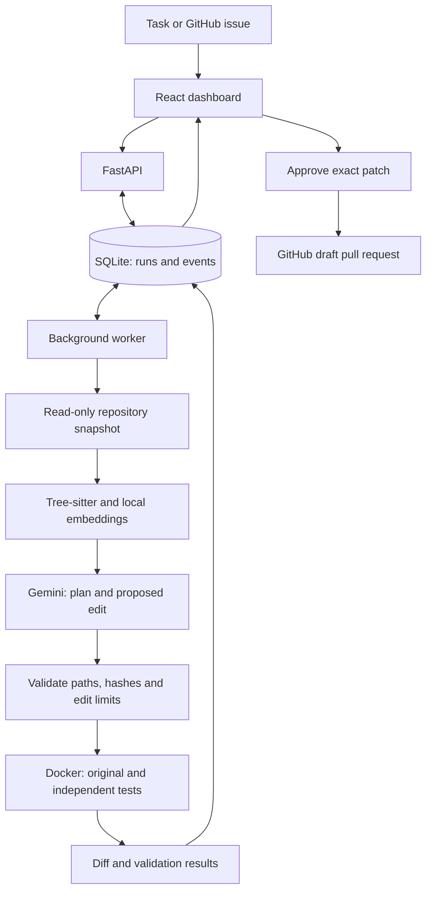

# CodePilot

CodePilot helps you inspect, fix and refactor Python code. It reads a task, finds
relevant source, asks Gemini for a proposed change, and tests that change in Docker.
You review the diff and test results before creating a draft pull request.

The current version runs locally and supports controlled Python examples. Live
Gemini generates new proposals; a separate offline mode uses fixed examples for
repeatable testing.

## What it does

- Indexes Python symbols with Tree-sitter and finds relevant code with local embeddings.
- Generates plans, bounded edits and supporting tests with Gemini.
- Runs original tests and independent checks in isolated Docker containers.
- Shows each attempt, its diff, test results and retrieved source in a React dashboard.
- Imports GitHub issues and publishes reviewed changes as draft pull requests.

## Architecture



The API manages requests; the worker handles indexing, generation and testing.
Repository tests run inside Docker, not on the host. The protected evaluator stays
outside Gemini's context. Failed checks trigger a bounded retry or stop the run.

## Folder structure

```text
backend/codepilot/   API, worker, retrieval, generation and GitHub integration
frontend/           React dashboard
runner/             Docker image and test harness
fixtures/           Small repair and refactoring examples
evaluation/         Independent checks and recorded evaluation results
tests/              Unit and integration tests
scripts/            Local startup script
docs/               Architecture decisions, lessons and verification evidence
.codepilot/         Local runs, snapshots, models and database (not committed)
```

## Installation

You need Linux, Git, Python 3.12, [uv](https://docs.astral.sh/uv/), Node.js 22.12+
and a running Docker Engine or Docker Desktop. GitHub CLI is optional unless you
want to import issues or publish draft PRs.

```sh
git clone https://github.com/ayatinkering/CodePilot.git
cd CodePilot
uv sync --locked
npm ci --prefix frontend
npm run build --prefix frontend
uv run --locked codepilot prepare-model
docker build -t codepilot-runner:dev runner
cp -n .env.example .env
docker image inspect codepilot-runner:dev --format '{{.Id}}'
```

Copy the printed image ID into `.env`. For live generation, add your Gemini key:

```dotenv
CODEPILOT_RUNNER_IMAGE=sha256:your-image-id
CODEPILOT_MODEL=gemini-3.5-flash
GEMINI_API_KEY=your-key
```

Keep `.env` private. Offline mode needs no API key. The first install downloads
dependencies, the embedding model and the Docker image; live mode sends selected
task/source content to Google and uses your API quota.

## Run

```sh
./scripts/start-demo.sh
```

Open **[localhost:8000](http://127.0.0.1:8000)**. Choose **boundary** for a bug fix or
**refactor** for helper extraction, select a generation mode, and click **Start run**.
Use the **Diff**, **Checks**, **Plan** and **Source** tabs to review the result.
The other examples demonstrate failed baselines, missing dependencies and zero tests.

Keep the terminal open. Press Ctrl-C to stop the server and worker. If the port or
worker lock is occupied, stop the previous instance first. Gemini failures are shown
explicitly; live runs never silently switch to scripted output.

## GitHub integration

Run `gh auth login` to connect your account. Import an issue by number in the
dashboard. Draft publication requires an operator-approved repository and base
branch, plus approval of the exact validated patch. New installations disable
publication by default. See the [publication setup](docs/github-setup.md).

The workflow has produced a [live repair draft PR](https://github.com/ayatinkering/CodePilot/pull/4).
Generated PRs are never merged automatically.

## Tests and evidence

```sh
uv run --locked pytest -q
uv run --locked ruff check .
uv run --locked ruff format --check .
# Include Docker integration tests:
CODEPILOT_TEST_RUNNER_IMAGE=$(docker image inspect codepilot-runner:dev --format '{{.Id}}') \
  uv run --locked pytest -q
# Stop the worker before running the offline evaluation:
uv run --locked codepilot evaluate
```

Two live Gemini examples passed independent Docker checks: a bug repair and a
helper extraction. The offline suite covers 12 acceptance scenarios, including
expected failures. These small examples are not a general repair benchmark.

[Live results](docs/evidence/live-generation.json) ·
[Offline results](evaluation/results/summary.md) ·
[Demo guide](docs/demo-guide.md)

## Current scope

This is a local, single-user prototype for trusted Python examples. It does not yet
support arbitrary repositories, public hosting or GitHub App webhooks. Structural
analysis is approximate, and passing tests do not prove every behavior is correct.
The frontend build and API flows are tested; a full visual browser walkthrough is
still pending.
