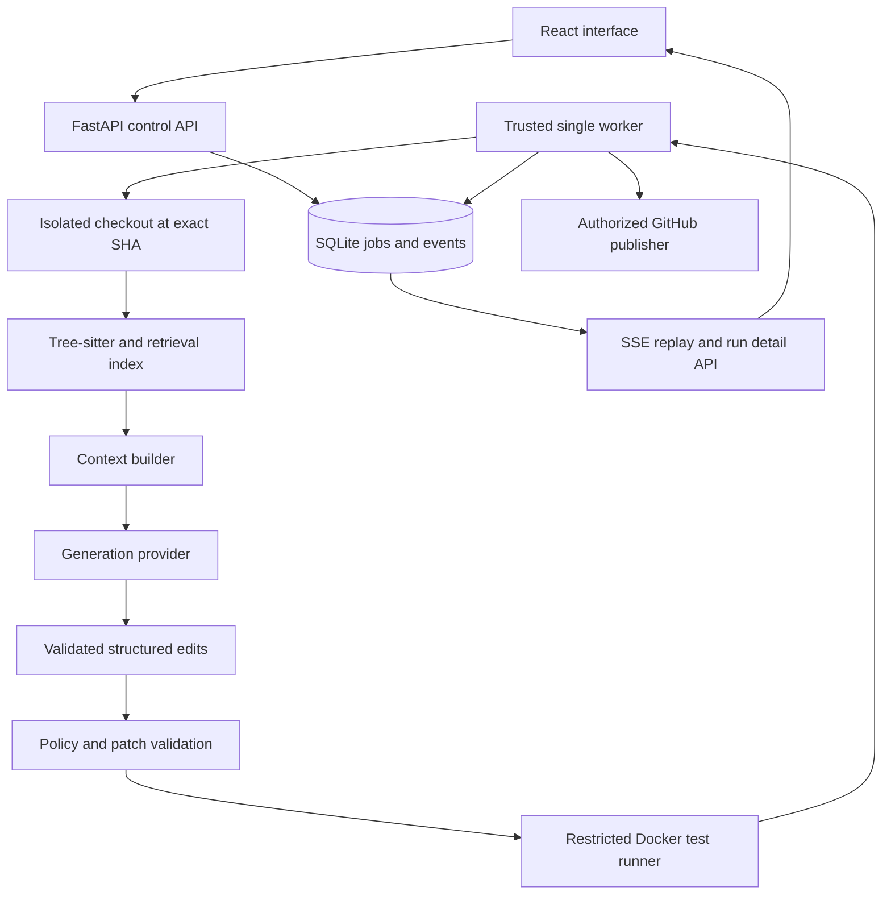

# CodePilot: product requirements and implementation contract

Prepared for Ayati Rauthan, 25 November 2026.
Implementation repository: https://github.com/ayatinkering/CodePilot
Repository contents endpoint reported an empty repository when checked for this handoff. Reinspect before modifying it.

## 1. Purpose and truthful starting point

Build an inspectable, reproducible software engineering research prototype. A user supplies a Python repository and a GitHub issue (or local task). CodePilot indexes the repository, retrieves relevant evidence, proposes a bounded plan, creates a patch, generates candidate tests, executes independent validation, performs bounded repair, and prepares a human-reviewable GitHub PR. A React/FastAPI interface exposes the actual execution record.

Ayati has disclosed that this project has not yet been implemented. Treat all CV capability statements as requirements, not evidence of completed work. Do not backdate commits, fabricate metrics, invent historical decisions, or describe AI-authored work as independently written by Ayati. Record actual contributions and what Ayati has learned, modified, and verified. New implementation does not retroactively validate an earlier CV claim.

The learning outcome is that Ayati can explain the implemented system, inspect its code, make small changes, and distinguish evidence from assumptions. No document or overnight build can guarantee mastery of every possible interview question.

## 2. Research alignment

Professor Tushar Sharma's supplied projects concern (a) commit-triggered LLM refactoring with quality checks and human-reviewed PRs, and (b) agents that detect and attempt to fix software engineering issues. CodePilot shares the analysis, retrieval, generation, validation, and review pipeline. Keep the distinction between bug repair (intentional behavior change) and refactoring (intended preservation of externally observable behavior).

Research hypothesis: structural repository context and layered validation may improve useful patch outcomes compared with prompt-only generation. This is a hypothesis to evaluate, not a result to advertise.

## 3. Users, workflows, and release levels

Primary user: a developer or student researching AI code modification on small, explicitly trusted Python repositories.
Secondary user: a reviewer who needs to inspect changes, tests, uncertainties, and execution history.

Core story: 'Given an issue in my Python repository, help me produce a small patch supported by repository evidence and tests, with a clear account of what happened.'
Refactoring story: 'Given a changed Python function or a commit diff, identify a bounded maintainability improvement, attempt it, and report the evidence for behavior preservation.'
Research story: 'Compare pipeline variants on the same tasks and budgets without concealing failures.'

Release levels:
- R0: deterministic offline walkthrough; clearly labeled simulated provider outputs, real parsing/retrieval/control flow/test execution.
- R1: live model, complete issue-to-validated-patch flow on a trusted local Python repository, usable web UI.
- R2: live GitHub issue ingestion and draft PR publication to an authorized repository; reproducible setup, CI, evaluation report.
- R3: bounded refactoring mode, compare-runs experiment, and optional GitHub App webhook integration.

Required completed product: R2 plus bounded refactoring mode and evaluation. Full installed GitHub App automation is an explicitly tracked extension, not a prerequisite for claiming R2. A manual commit-SHA analysis mode is required. If webhook automation remains unfinished, say so visibly.

Do not stop at R0 or a polished mockup. If credentials or execution capabilities block live verification, finish independent work and report the exact blocked acceptance items.

## 4. Scope and defaults

Supported target code: Python 3.12, small repositories using a documented pytest-compatible test profile. The product UI itself uses TypeScript; that does not mean TypeScript target repositories are supported.
Initial repository limits: 2,000 eligible files, 10 MB indexed source, 200 KB per file, 50 changed lines per candidate by default, 3 edited production files per candidate. Make limits configurable and persist their actual values per run.
Default generation budget: initial candidate plus at most 2 repair attempts; maximum 8 generation calls (including planning/test generation), 10 minutes total run wall time, 120 seconds per test invocation. Token budget configurable with a conservative explicit default. Reject requests exceeding hard bounds.
Run concurrency: one worker job at a time in v1. Queue other jobs. Per-repository publication lock.
Target dependency execution: trusted curated fixtures first; no arbitrary uploaded archive execution, automatic repository installation, or public multi-tenant hosting.
Non-goals: training a foundation model; proving arbitrary semantic equivalence; complete dynamic-language call resolution; autonomous merging; exploit generation; enterprise access control; unrestricted shell agents; multi-agent orchestration for its own sake; support for arbitrary language/build systems.

## 5. Architecture decision baseline

Use a straightforward modular monolith with a separate worker process. Do not add distributed services unless required by evidence.

Suggested stack:
- Python 3.12, FastAPI, Pydantic, typed service modules.
- SQLite for jobs, checkpoints, events, metadata, and small-repository index storage. Use WAL, short transactions, migrations, one worker, and explicit state transitions. SQLite is a deliberate single-user scope choice.
- Tree-sitter Python grammar for syntax analysis, with pinned compatible bindings/grammar versions.
- A local SentenceTransformers-compatible embedding model and NumPy cosine similarity for the first small index. Select and verify the actual model at implementation time; record model ID, revision, dimension, normalization, license, and download requirements. Do not label hashed tokens or random vectors as semantic embeddings.
- Lexical/symbol search plus vector retrieval and structural expansion. For the small corpus, brute-force similarity is an understandable baseline; document O(Nd) query cost and migration triggers for an ANN index.
- A provider interface for structured generation, with one real provider wired end-to-end and an explicit deterministic fake for tests/offline mode. Select an available provider/model using current official docs and existing authorized credentials. Do not invent model IDs or silently switch providers.
- React, TypeScript, Vite, CSS; FastAPI REST and Server-Sent Events (SSE) for run updates.
- A locally running trusted worker delegates tests to restricted ephemeral Docker containers. The API/UI must not expose arbitrary Docker or shell operations. Docker daemon access remains a privileged trusted-host boundary, not something exposed to repository code.
- Git CLI through argument arrays for local version operations and GitHub REST API/client for issues/PRs. Avoid shell string interpolation.
- pytest, frontend component tests where useful, and browser verification for the complete flow.

Architecture:



Explain each decision and at least one rejected alternative in an ADR. Use an explicit Python state machine before considering an agent framework. A framework is an optional orchestration convenience, not the source of intelligence or correctness.

## 6. Execution state and recovery

States: queued → preparing → baselining → indexing → retrieving → planning → generating → validating → repairing (if permitted) → ready_for_review → publishing → published. Terminal alternatives: failed, abstained, cancelled, interrupted, publication_uncertain.
Transition rules enforced in the backend. Every transition emits a persisted sequence-numbered event.
Jobs must not be long-running FastAPI request handlers or untracked BackgroundTasks. A separate worker claims a job transactionally. For v1, process restart marks in-flight work interrupted; explicit retry starts a fresh attempt against the same recorded base SHA. Do not claim arbitrary automatic resume. Publication recovery reconciles remote state before another write.
Cancellation interrupts model requests where supported, stops execution containers, and prevents later publication. Persist events already produced.

## 7. Functional requirements and acceptance tests

### F01 Repository registration and acquisition
Accept an allowlisted local repository or validated GitHub HTTPS repository URL. Read GitHub issues by repo and issue number. Local tasks use the same normalized schema. Reject arbitrary URL schemes, internal-network fetch destinations, credential-bearing URLs, traversal paths, symlinks escaping the workspace, and oversized inputs.
Resolve and record base SHA. Work in a new managed checkout; never mutate the user's original worktree. Disable hooks/submodules/automatic LFS execution for acquired code. Ignore generated directories, secrets, binaries, and excluded files. In v1, remote targets must be explicitly authorized/trusted before executing tests.
Acceptance: original worktree remains byte-for-byte unchanged; branch movement after acquisition does not change the run; invalid paths rejected; skipped files and reasons visible.

### F02 Baseline validation
Before generation, run the configured trusted test profile in the runner and store test IDs/outcomes, exit status, collection errors, runtime, environment/image digest, and logs.
Distinguish product defects from environment/dependency failures, timeouts, zero collected tests, and flaky/unstable results.
Default: baseline failure prevents automatic publication and produces a diagnostic. An explicit research mode may continue, reporting baseline failures separately and requiring protected issue-specific evidence before claiming repair. Do not turn baseline failures into successful outcomes by excluding tests.
Acceptance: pre-existing failure fixture is labeled baseline_failed; missing dependency is environment_error; zero tests never becomes validated_success.

### F03 Structural indexing
Extract modules, classes, functions, methods, signatures, docstrings, imports, source spans, nesting and call expressions. Retain file hash, base SHA, parser version and parse-error status.
Tree-sitter constructs a concrete syntax tree. The application's normalized symbol representation may be AST-like. Explain that distinction.
Represent import and call edges with resolution status: resolved_local, heuristic, unresolved. Do not claim a sound whole-program call graph. Dynamic imports, monkey patching, inheritance and runtime dispatch remain limitations.
Implement a small transparent set of maintainability signals: function length, nesting depth, parameter count and an explicitly defined branch/complexity heuristic. Thresholds are configurable suggestions, not objective proof of a smell. Defer sophisticated duplication/God Class analysis unless genuinely implemented and tested.
Acceptance: fixtures for decorators, nested functions, async methods, aliases, malformed source and unresolved calls have expected extraction; findings cite exact ranges.

### F04 Retrieval and incremental indexing
Chunks follow function/class boundaries. Oversized units split into labeled spans with parent symbol information; module-level code and relevant tests/config docs use separate bounded chunks.
Store actual local semantic embeddings with metadata. Query through lexical/symbol and semantic channels, fuse ranks (e.g. reciprocal-rank fusion), expand a bounded number of structural neighbors, deduplicate and fit a context budget. Show all selected chunks with source references and retrieval channels/scores. Do not call scores calibrated confidence.
After edits, update changed/deleted chunks and dependent edge metadata using content hashes; key caches by repository, snapshot hash, parser config and embedding revision. Never mix vectors from different models/dimensions. Patch-attempt indexes must not overwrite the immutable baseline index. Exclude evaluator-only tests and answers.
Acceptance: deleted/renamed symbols cannot be returned as current context; repeated indexing of unchanged content skips embedding work; query result has inspectable evidence; model revision change invalidates cache.

### F05 Task planning and model interface
Build a typed task object: issue text, mode (repair/refactor), constraints, evidence references, proposed files, acceptance criteria and risks. Plan output contains a short user-facing rationale and steps, not purported hidden model chain-of-thought.
Repository text, issue content and tool outputs are untrusted data. They cannot authorize tools or override policy. Enforce allowed operations in code. Schema-validate model output, limit retries, redact credentials, record actual model/settings/usage. Account for context length and truncate with visible warnings.
Offline mode uses labeled fixtures. Live mode must never fall back to fake success when credentials, rate limits or provider calls fail.
Acceptance: malformed JSON is handled with bounded recovery; injected repository instruction requesting secrets does not alter tool permission; unknown source reference rejected; provider failure visible.

### F06 Patch generation and application
Use a structured edit format, such as path + expected preimage hash + exact old/new span content, validated before applying in a candidate checkout. Reject ambiguous replacements; do not blindly fuzzy-apply. Generate a conventional unified diff after application for review/export. An ADR can choose direct diff generation if equivalent validation is implemented.
Default protected paths: .git, credentials/env files, CI configuration, dependency manifests/lockfiles, runner settings and existing tests. Allow only configured source paths. New generated tests live in a designated location; changing existing tests requires a separate explicit user choice and invalidates automatic publication until reviewed.
Bound patch size/file count. Reject path escapes, binaries, unsafe file modes and deletion of protected checks. Parse and inspect the actual resulting diff, not just the declared edit list.
Acceptance: traversal, symlink writes, wrong preimage, oversized changes and test deletion rejected; valid patch produces expected diff; failed candidate does not contaminate next attempt.

### F07 Test generation and independent validation
Generate proposed tests from the issue/specification and pre-change context. Preserve original tests and keep evaluator checks inaccessible to the generator. Distinguish existing, generated and evaluator tests in storage/UI.
For repair, assess whether issue-specific tests fail on baseline and pass on candidate when feasible. A generated test that passes both versions may be useful regression coverage but is not evidence of reproducing the bug.
For refactoring, preserve behavior using existing and targeted characterization/differential/property tests as applicable. Generated tests are auxiliary evidence, not an independent oracle. The model may make the same mistake in both code and tests.
Apply syntax compilation, configured lint checks, test suite comparison and scope policy. Compare pre/post targeted maintainability signal for refactoring. Independent evaluation decides success; generated assertions do not define benchmark truth.
Acceptance: a patch that disables assertions or weakens original tests is rejected; an invalid generated test is reported separately; protected evaluator catches a superficially passing incorrect patch.

### F08 Execution boundary
Never run target tests, dependency setup scripts or generated code directly on the host. Test containers run non-root, network disabled, capabilities dropped, no-new-privileges, process/memory/CPU limits, default seccomp, read-only root where feasible and bounded ephemeral writable workspace/tmp. No host home, cloud credentials, provider key, GitHub token or Docker socket inside target containers. Kill the container/process group on timeout/cancellation and clean workspaces by policy.
For v1, prebuild a documented runner image with vetted test dependencies; do not run arbitrary pip installs from target repos. Unsupported dependencies return environment_error with setup guidance. Separate operator-approved dependency/image preparation from offline test execution.
The trusted local worker may control the local Docker daemon; explain its privilege and why no untrusted code runs in that worker. Prefer rootless Docker when practical. A container shares a kernel and is not a hardened universal sandbox: v1 is local/single-user on trusted targets, not a public service for hostile repositories.
Acceptance: infinite loop times out; network access unavailable; secret env variables absent; source cannot write outside container's allowed mounts; no unrestricted host subprocess fallback if Docker is unavailable.

### F09 Bounded repair and abstention
Parse structured pytest reports where available; retain raw logs with size caps. Classify failures (syntax, assertion, import, environment, policy, timeout, model output). Supply concise relevant diagnostics to the next attempt.
Default maximum three code candidates total: one initial + two repairs. Also enforce wall-clock/token/call budgets. Detect repeated identical patch or failure signatures. Stop on no progress, unsupported task, insufficient evidence, cancellation or budget exhaustion. Return failed/abstained rather than opening an unjustified PR.
Acceptance: intentionally unfixable task terminates predictably; exact attempt count visible; successful second attempt recorded as such; provider timeout cannot cause an endless loop.

### F10 GitHub integration and publication
Development of CodePilot and CodePilot's own PR-publishing feature are separate workflows.
Product reads an issue and binds it to a base SHA. After ready_for_review, show diff and validation evidence. User chooses Create draft PR. For automated controlled demos, a preauthorized repository allowlist can replace a per-run click; never publish to arbitrary third-party repositories.
Use backend-only credentials with minimum documented access. Support one authentication route end-to-end first. GitHub App installation auth is an extension unless selected as the actual initial route. If selected, implement token refresh and permission/error handling genuinely.
Before publishing, ensure base/head expectations and approved patch digest are unchanged. If target moved, mark stale and revalidate against the new base rather than silently claiming old results. Use deterministic branch name from run ID and a PR marker; reconcile prior branch/PR before retry. Network uncertainty becomes publication_uncertain until reconciled. Never auto-merge or force-push.
PR body: source issue, purpose, exact base SHA, changes, test results and baseline status, known limitations, model configuration, generation-provider provenance and run identifier. Do not auto-close unrelated issues.
Acceptance: one real issue-to-draft-PR run on an authorized test target; duplicate button/retry yields one PR; no token in logs, browser bundle or target execution; failed validation disables publication by default.

### F11 Interface and observability
Required views: repository/task entry; configuration/model mode; run list; run details; indexed symbol/context inspector; proposed plan; diff; test results before/after; candidate attempts; event timeline; artifact download; publish status and PR link.
SSE uses sequence IDs and reconnect replay; refreshing a page reconstructs persisted state. Polling fallback allowed. Display timeouts, empty states, unavailable credentials, interrupted runs and cancellations. No invented progress percentages or synthetic events presented as real.
Timeline includes tool name, sanitized args summary, start/end, result summary, duration and artifact links. Expose concise action rationales and evidence, not hidden reasoning traces. Redact secrets and escape untrusted HTML/Markdown.
Acceptance: browser walkthrough from task submission to diff and PR; refresh/reconnect retains history; failure/cancel flow works; keyboard labels and readable narrow-screen layout; genuine screenshot evidence.

### F12 Refactoring/commit mode
Support explicit commit/base SHA analysis and a user-selected candidate. Compute affected function context, analyze transparent maintainability signals, and propose a narrow transformation. Initial focus: Extract Helper/Method for suitable small functions, subject to boundary/side-effect tests. Detection may abstain. Do not pretend heuristic detection proves suitability.
Explain variable scope, return/exception behavior, state mutation, I/O order, closures, resource management and async semantics. Prefer simple supported cases; explicitly reject unsupported transformations.
Existing tests must pass before and after. Add suitable differential/property/characterization evidence, and show the targeted structural metric change. Distinguish confidence from proof. A smaller function with changed behavior fails acceptance.
Acceptance: one valid refactoring fixture; one plausible change rejected for behavior regression; one no-change/unsupported case. Real model run required for a live capability claim.

### F13 Evaluation and export
Create 12 curated tasks initially: 6 repair, 3 refactoring, 3 refusal/environment/unsupported cases. Store fixed base snapshots, task text, expected acceptance rules, independent evaluator and provenance. Keep evaluator-only files outside the indexed agent workspace and generation context. Disclose fixtures written by the same project team; this is a small development benchmark, not unseen industry validation.
Compare A: issue + minimal source context, B: hybrid retrieval, C: retrieval + structural expansion + bounded feedback. Same model, task versions and budgets; disclose feedback changes the effective compute budget and report actual costs. Report a one-candidate comparison separately when isolating retrieval impact. For repair, use protected regression and issue tests. For refactoring, include preservation plus targeted quality criteria. For negative tasks, report correct abstention separately from patch success.
Results: raw numerators/denominators, candidate counts, resolved tasks, behavior regressions, abstention, environment errors, latency, provider tokens/cost if known, model/revision, timestamps and random/sampling settings. Do not report classifier accuracy or detection precision without appropriate labels/denominators. No claims of statistical significance from a tiny sample. Never select only successful runs.
Separate offline fixture runs from live model results. Publish baseline experiment failures. If costs are estimates, record rate source/date and label estimate. No model fine-tuning or RL claim for inference-time repair.
Acceptance: machine-readable JSON/CSV report plus human summary generated from results; reproducible commands; at least one documented real failure. Partial evaluation is labeled partial with missing cases.

## 8. Data contracts

Minimum entities:
- Repository: id, canonical URL/path, allowlist/trust setting, default branch, indexed limits.
- Snapshot: repo_id, commit SHA, content/config hashes, parser and embedding IDs, creation time.
- Symbol: snapshot_id, qualified name, kind, path, start/end line, signature, parse status.
- Edge: caller/source, target or unresolved text, type, resolution status.
- Chunk: snapshot_id, symbol reference, text hash, source range, embedding metadata/vector.
- Run: task, mode, base SHA, state, budgets, provider settings, timestamps, terminal reason.
- Candidate: run_id, attempt index, parent/base digest, plan, patch digest, changed files, checks.
- TestReport: candidate/baseline, test origin, per-test outcomes, exit code, environment errors.
- Event: run_id, sequence, type, timestamp, payload with sanitized fields.
- Publication: run_id, approved patch digest, branch, PR URL/id, reconciliation status.

Artifacts live under a managed per-run directory. Persist metadata transactionally; do not store secrets. Logs expire by configurable retention; delete indexes/workspaces through a scoped command. Explain which artifacts may contain repository source.

Suggested API:
- POST /api/repositories; GET /api/repositories/{id}
- POST /api/repositories/{id}/index; GET /api/repositories/{id}/symbols
- POST /api/repositories/{id}/search
- POST /api/runs; GET /api/runs; GET /api/runs/{id}
- GET /api/runs/{id}/events (SSE, sequence replay)
- GET /api/runs/{id}/candidates/{attempt}; GET /api/runs/{id}/artifacts/{artifact_id}
- POST /api/runs/{id}/cancel; POST /api/runs/{id}/retry
- POST /api/runs/{id}/publish (expected patch digest and base SHA)
- GET /api/health; GET /api/capabilities (available model/runner/GitHub services without secrets)

No endpoint takes an arbitrary shell command or arbitrary artifact filesystem path. Bind to loopback by default; protect state-changing endpoints with a local session token/origin checks, restrict CORS, and document that remote exposure requires proper authentication/TLS.

## 9. Repository layout

```text
backend/codepilot/{api,domain,worker,indexing,retrieval,providers,patching,validation,github,storage}/
frontend/src/{components,pages,api}/
runner/
tests/{unit,integration,security}/
fixtures/targets/
evaluation/{tasks,evaluator,reports}/
scripts/
docs/{architecture,adr,lessons,interview,evidence}/
README.md
.env.example
pyproject.toml
frontend/package.json
compose.yaml
```

Use actual lockfiles. Never commit credentials, local source indexes, private-repository content, raw sensitive prompts, model caches or huge generated artifacts. Include a dependency/license note; select the project license with the user before adding one if preferences are unknown.

## 10. Milestones: teach → implement → verify → commit → push

Each milestone updates docs, capability ledger, decision notes and teaching materials. Each is a real tested vertical increment. Commit/push instructions are in 03-ASTRA-START-HERE.md.

| ID | Major feature | Required verification | Course modules |
|---|---|---|---|
| M0 | Repo bootstrap, configuration, schema, capability ledger | Clean install; health; secret ignore rules | 0–2 |
| M1 | Safe checkout, worker state/events and baseline runner | Original untouched; baseline fail/timeout/cancel | 3, 8 |
| M2 | Tree-sitter symbol/edge extraction | Structural fixtures, parse-error handling | 4 |
| M3 | Real embeddings, hybrid search, incremental cache | Semantic query, exact symbol, invalidation | 5 |
| M4 | Typed planner and provider adapters | Live planning smoke test; explicit offline mode | 6 |
| M5 | Bounded structured patch application | Valid patch and malicious/ambiguous edits | 7 |
| M6 | Test generation, independent checks, repair loop | Good repair, false success, no-progress stop | 8–9 |
| M7 | React run UI and inspectable artifacts | Complete browser flow, replay and cancellation | 10 |
| M8 | GitHub issue import and draft PR publication | Real authorized PR, idempotency, stale base | 11 |
| M9 | Commit analysis and bounded refactoring | Preserved behavior, rejected regression, abstention | 12 |
| M10 | Evaluation, clean-machine setup, interview pack | Raw report, fresh clone, demo and limitations | 13–15 |

Build a runnable CLI/debug entry alongside the API so backend progress is demonstrable before UI completion. M7 should consume real backend events. If time is constrained, reduce supported task breadth, not independent validation or honest status reporting.

## 11. Definition of done

- New clone installs from documented commands and pinned dependencies.
- A documented startup launches UI/API/worker with sensible local defaults; test runner setup is explicit. Do not hide privileged Docker socket mounting in compose.
- Offline demo runs with clear labels; live provider mode succeeds at least once with recorded model/configuration.
- All CV-listed capabilities map to implementation paths and executable evidence in docs/evidence/capabilities.md.
- Real authorized GitHub issue → patch → tests → draft PR is recorded with URL and commit SHA.
- Refactoring mode demonstrates both a success and a correctly rejected candidate.
- CI checks pass; browser flow verified; API errors are actionable.
- Evaluation report includes failures and scope, never fabricated rates.
- Each major feature has a pushed commit and lesson; remote HEAD confirmation is recorded.
- README explicitly states local single-user/trusted-target boundaries and unfinished GitHub App automation, if any.
- Interview answers describe the implementation as it exists, including limitations and verified understanding.

## 12. Sources and facts to verify during implementation

Official documentation is authoritative for current APIs, dependency compatibility and model availability. Pin actual versions after checking them; this PRD is not an API compatibility guarantee.
- Repository: https://github.com/ayatinkering/CodePilot
- Tree-sitter CST and incremental parsing: https://tree-sitter.github.io/tree-sitter/
- GitHub PR REST API: https://docs.github.com/en/rest/pulls/pulls
- GitHub webhook handling: https://docs.github.com/en/webhooks/using-webhooks/best-practices-for-using-webhooks
- Docker security boundaries: https://docs.docker.com/engine/security/
- FastAPI background-task caveats: https://fastapi.tiangolo.com/tutorial/background-tasks/
- Sharma lab: https://web.cs.dal.ca/~tushar/smart/
- SE grounding paper: https://tusharma.in/preprints/SANER2026_SENAI.pdf
- Refactoring alignment paper: https://tusharma.in/preprints/EASE2025_RL_Refactoring.pdf

The stack, numerical limits, milestones and experiment design above are proposed engineering choices for this project, not requirements attributed to Professor Sharma.
